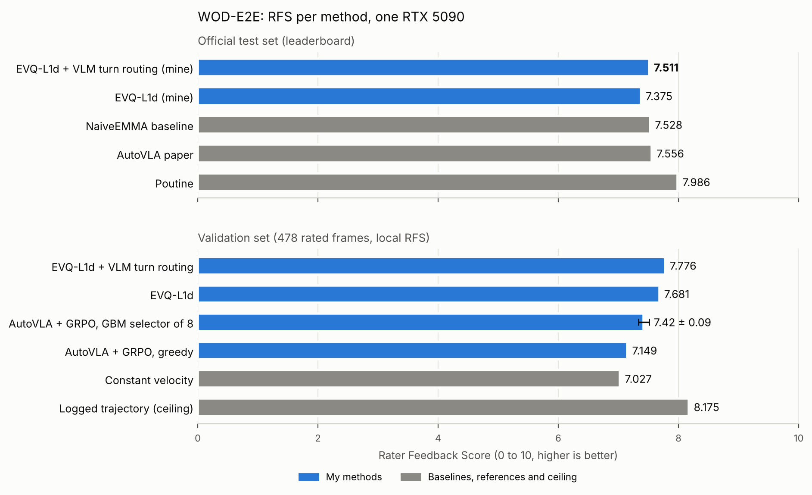

# waymo-e2e-driving

Vision-based end-to-end driving on the Waymo Open Dataset (WOD-E2E) with one RTX 5090. Best official test score: RFS 7.511.



Task: [Waymo Vision-based End-to-End Driving Challenge](https://waymo.com/open/challenges/2025/e2e-driving/). Metric: Rater Feedback Score (RFS, 0 to 10).

## Results

### Official test set (leaderboard)

| Method | RFS |
|---|---|
| **EVQ-L1d + VLM turn routing (IST), mine, 2026-10-07** | **7.511** |
| EVQ-L1d (IST), mine, 2026-10-06 | 7.375 |
| NaiveEMMA, Waymo baseline | 7.528 |
| AutoVLA paper | 7.556 |
| Poutine, best method in the WOD-E2E paper table | 7.986 |

The best entry is a constant-velocity-anchored ExtraTrees baseline with a gated residual correction from explicit visual quantities. On turn-command scenes the along-track part comes from a QLoRA-finetuned Qwen3-VL-8B driving model (182 of 1505 test scenes).

Per-category RFS of the best entry: Single Lane 7.978, Foreign Object Debris 7.926, Special Vehicle 7.825, Intersection 7.787, Construction 7.751, Cyclist 7.717, Cut In 7.433, Pedestrian 7.418, Multi Lane 7.284, Others 7.125, Spotlight 6.376. ADE is 1.228 m at 3 s and 2.811 m at 5 s.

Reference scores are from the [WOD-E2E paper](https://arxiv.org/abs/2510.26125).

### Validation set (478 rated frames, local RFS metric)

| Method | RFS | At floor (<= 4) |
|---|---|---|
| **EVQ pipeline (the test entries above)** | | |
| **EVQ-L1d + VLM turn routing** | **7.776** | |
| EVQ-L1d | 7.681 | |
| **AutoVLA pipeline (code in this repo)** | | |
| SFT, greedy (LoRA + trained action embeddings, 1 epoch) | 7.013 | 26.8% |
| + GRPO v1, pseudo-RFS reward (G=8) | 7.120 | 23.4% |
| + GRPO v2 (G=16, top-8 advantage backward, cosine lr, skip-list) | 7.145 | 23.0% |
| + GRPO v3 (2000 steps, T=1.1) | 7.149 | 22.6% |
| GRPO v3, medoid of 8 samples | 7.36 | |
| GRPO v3, GBM selector of 8 samples | 7.42 ± 0.09 | |
| **Measured baseline and ceilings** | | |
| Constant velocity | 7.027 | 26.9% |
| Best of 8 samples, oracle (selection ceiling) | 8.38 | |
| Logged trajectory (imitation ceiling) | 8.175 | 9.4% |
| Best rater trajectory per frame (preference ceiling) | 9.600 | |

Notes:
- Turn routing adds +0.095 RFS over EVQ-L1d on validation (confidence interval 0.029 to 0.162).
- Medoid and selector rows are the mean of 2 independent sampling batches of 8 rollouts. The ± value is the spread between batches.
- The selector beats the medoid on both batches.
- The code in this repo is the AutoVLA pipeline. The code of the EVQ pipeline is not in this repo yet.

## Key findings (AutoVLA pipeline)

**1. LoRA leaves the new action-token embeddings untrained.**
AutoVLA adds 2048 action tokens to the vocabulary. With LoRA on the attention layers only, their embeddings and `lm_head` rows stay frozen at random init. The model then collapses to an output that does not depend on the input (RFS 4.1). Fix: `modules_to_save=["embed_tokens", "lm_head"]` in the `LoraConfig`. Validation loss drops from 3.30 to 1.14 and RFS rises from 4.1 to 7.0. See `patches/0003-run-sft-lora.patch`.

**2. GRPO needs per-prompt groups on one GPU.**
Upstream normalises the reward across the samples gathered from all GPUs. On one GPU this gives zero advantage. `train/run_rft_waymo.py` samples G rollouts per prompt in sequence and normalises inside the group. It runs backward on the 8 rollouts with the largest absolute advantage, uses a cosine learning rate, and skips scenes where all rollouts get the same reward. Training frames have no rater labels, so the reward is a pseudo-RFS: the logged trajectory acts as one rater with score 10 (`rfs/gt_rfs_reward.py`).

**3. A learned selector beats medoid selection.**
The policy samples 8 trajectories per scene. A gradient-boosted regressor scores each one from 14 geometric and likelihood features (centrality in the group, group spread, lateral endpoint, initial speed, log-probability). It is trained on 16k training scenes x 8 rollouts with pseudo-RFS labels. Result: 7.42 against 7.36 for the medoid. The oracle is 8.38, so selection is the main lever.

**4. Negative results (all measured on the 478 rated frames).**
- Curriculum RL on the hardest 35% of training scenes (v4): 7.137 against 7.149. No gain.
- Larger pool (K=16): the oracle rises from 8.38 to 8.61, but the selector picks get worse. The judge is too noisy for a larger pool.
- Locked-prefix resampling around the selector pick (trust-region search in action-token space): 7.351 against 7.350 for independent sampling.
- Adding the constant-velocity trajectory to the pool, intent-consistency filtering, entropy features: no net gain.
- Takeaway: every pool-side method stops at the same level. The geometric selector cannot see the scene.

## Repository layout

| Path | Content |
|---|---|
| `rfs/` | Local RFS evaluation (`local_rfs.py`) and the pseudo-RFS reward (`gt_rfs_reward.py`) |
| `data/` | OOM-safe LMDB builder and the builder of the 478-frame rated eval set |
| `train/` | Single-GPU GRPO runner |
| `eval/` | Constrained-decode evaluation, best-of-K with logprob and medoid selectors, negative-result tests |
| `selector/` | Selector data builder, training and inference |
| `configs/` | Dataset and training configs |
| `patches/` | My changes to upstream AutoVLA files |
| `third_party/` | Waymo `rater_feedback_utils.py` (Apache-2.0) |

## Setup

AutoVLA code is not in this repo. The setup script clones it at commit [`ba34eed`](https://github.com/ucla-mobility/AutoVLA/commit/ba34eed74ce6729e7986592d0e66cbaca397b4fa), applies the patches and copies my scripts in.

```bash
git clone https://github.com/ZahraRezaee11/waymo-e2e-driving
cd waymo-e2e-driving
bash scripts/setup_autovla.sh AutoVLA
cd AutoVLA
pip install -e .
pip install peft lmdb scikit-learn joblib
mkdir -p dataset && ln -s /path/to/waymo_e2e dataset/waymo_e2e   # folder with the WOD-E2E tfrecords
```

Patches (all apply to commit `ba34eed74ce6729e7986592d0e66cbaca397b4fa`):

| Patch | Change |
|---|---|
| `0001-requirements-loosen-torch-pins.patch` | `torch`, `torchvision`, `triton` pins changed to `>=` (RTX 5090 needs a newer torch) |
| `0002-nocot-lazy-nuplan-import.patch` | nuPlan import moved inside the nuPlan branch |
| `0003-run-sft-lora.patch` | Applied to a copy of `tools/run_sft.py`: LoRA with trainable action embeddings, bf16, single GPU |

Run from the `AutoVLA` folder:

```bash
# 1. data
python tools/preprocessing/waymo_e2e_image_extraction.py --dataset_folder dataset/waymo_e2e --output_folder dataset/waymo_e2e/training_images --split training
python tools/preprocessing/waymo_e2e_image_extraction.py --dataset_folder dataset/waymo_e2e --output_folder dataset/waymo_e2e/val_images --split val
python ours_scripts/build_lmdb.py training
python ours_scripts/build_lmdb.py val
python ours_scripts/local_rfs.py                      # caches the rated frames, prints the constant-velocity RFS
python tools/preprocessing/nocot_sample_generation.py --config dataset/waymo-train-ours --output_dir ./dataset/waymo_train
python make_eval_samples.py                           # 478 rated eval samples

# 2. SFT
python tools/run_sft_lora.py --config training/waymo-sft-train

# 3. GRPO (set model.sft_model_path in each config to your checkpoint)
python ours_scripts/gt_rfs_reward.py --build ./dataset/waymo_train
python tools/run_rft_waymo.py --config training/waymo-rft
python tools/run_rft_waymo.py --config training/waymo-rft-v2
python tools/run_rft_waymo.py --config training/waymo-rft-v3

# 4. evaluation
python eval_rfs.py --ckpt <ckpt> --config config/training/waymo-rft-v3.yaml          # greedy
python eval_rfs_bestofk.py --ckpt <ckpt> --config config/training/waymo-rft-v3.yaml  # best of 8, logprob, medoid
cp eval_bestofk_results.npz eval_bestofk8_backup.npz                                 # batch 1, then run best-of-8 again for batch 2

# 5. selector
python make_selector_data.py --ckpt <ckpt> --out selector_data.npz    # repeat with --out selector_data2.npz and selector_data3.npz
python train_selector2.py                                             # trains and saves selector_gbm_merged.pkl
python selector_infer.py --npz eval_bestofk_results.npz
```

The data folder defaults to `./dataset/waymo_e2e`. Set `WOD_E2E_ROOT` to use another folder.

No checkpoints and no Waymo data are in this repo. Get the data from the [Waymo Open Dataset](https://waymo.com/open/) under its own terms.

## Hardware

One RTX 5090 (32 GB). SFT takes about 16 GB of VRAM. Everything uses Waymo data only, with no chain-of-thought annotations.

## Credit

Built on [AutoVLA](https://github.com/ucla-mobility/AutoVLA). AutoVLA code is under its own licence (UCLA Academic Software License) and is not included here. You must get it from the original repository and follow its licence.

```bibtex
@article{zhou2025autovla,
  title={AutoVLA: A Vision-Language-Action Model for End-to-End Autonomous Driving with Adaptive Reasoning and Reinforcement Fine-Tuning},
  author={Zhou, Zewei and Cai, Tianhui and Zhao, Seth Z. and Zhang, Yun and Huang, Zhiyu and Zhou, Bolei and Ma, Jiaqi},
  journal={Advances in Neural Information Processing Systems (NeurIPS)},
  year={2025}
}
```

`third_party/waymo_open_dataset/rater_feedback_utils.py` is from the [Waymo Open Dataset](https://github.com/waymo-research/waymo-open-dataset) code and keeps its Apache-2.0 licence.

## Licence

My own code in this repo is under the MIT licence (see `LICENSE`). This does not cover AutoVLA, the Waymo utility in `third_party/`, or the Waymo data.
